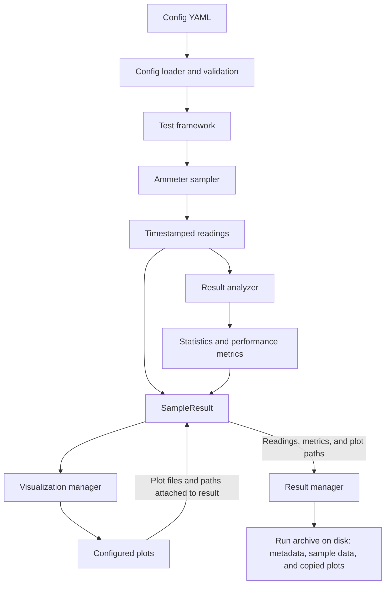

# Testing Infrastructure

The testing infrastructure coordinates ammeter measurement runs. It loads and validates configuration, collects timestamped readings, calculates statistics and timing metrics, and sends results to visualization and storage components.

## Package Structure

```text
src/
├── testing/
│   ├── test_framework.py       # Run orchestration and public testing API
│   ├── ammeter_sampling.py     # Measurement acquisition and sampling schedules
│   ├── result_analyzer.py      # Statistical and sampling-performance metrics
│   ├── visualization.py        # Plot functions and visualization manager
│   ├── result_manager.py       # Result records and disk persistence
│   ├── exceptions.py           # Framework-specific errors
│   └── tests/
│       ├── test_ammeters.py    # Simulator-backed integration tests
│       ├── test_infra_unitests.py # Infrastructure unit tests
│       └── conftest.py         # Shared pytest configuration
└── utils/
    └── config.py               # YAML loading and configuration models
```

## Run Data Flow



The framework coordinates the run: configuration is loaded first, the sampler returns timestamp/current pairs, and the analyzer produces statistics and sampling-performance metrics. These are combined with the readings in a `SampleResult`. The visualization manager generates the configured plots and adds their paths to that result. The result manager then archives the readings and metadata and copies the plot files into the run archive on disk.

## Component Responsibilities

| Component | Responsibility |
| --- | --- |
| `test_framework.py` | Builds the run components from configuration and coordinates sampling, analysis, visualization, and persistence. |
| `ammeter_sampling.py` | Requests readings from configured ammeters and schedules samples at the configured frequency. It can sample multiple ammeters concurrently. |
| `result_analyzer.py` | Calculates configured statistical metrics and timing measures such as mean interval and interval jitter. |
| `result_manager.py` | Defines `SampleResult` and `ResultRecord`, writes readings and metadata to disk, and supports retrieving and filtering saved runs. |
| `visualization.py` | Provides time-series, histogram, and boxplot functions, and creates configured plots from a `SampleResult`. |
| `utils/config.py` | Loads YAML and validates sampling, ammeter, analysis, and result-management settings into configuration models. |
| `exceptions.py` | Defines domain-specific errors for acquisition, configuration, analysis, visualization, and result archives. |

## Test Layers

- **Simulator integration tests** exercise the full measurement path: the simulator provides readings, the framework analyzes them, and results can be visualized and stored.
- **Infrastructure unit tests** check framework components such as analysis, result persistence, and visualization behavior independently of live measurement runs.

The test suite has its own setup and execution guide in [`tests/README.md`](tests/README.md).
